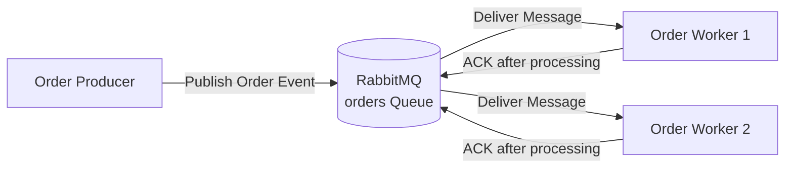

# RabbitMQ Asynchronous Order Processing System

A small asynchronous messaging system built with **Python** and **RabbitMQ**. The project demonstrates message publishing, competing consumers, manual acknowledgments, message redelivery after worker failure, and idempotent duplicate handling.

---

## 1. Project Overview

The system consists of an **Order Producer**, a **RabbitMQ queue**, and multiple **Order Workers**.

The producer publishes order events to RabbitMQ. Two independent worker processes consume messages from the same queue and act as **competing consumers**.

The project also demonstrates RabbitMQ's behavior when a worker fails before acknowledging a message and shows how duplicate events can be handled safely using `event_id`.

---

## 2. Architecture



### Message Flow

```text
Order Producer
      |
      | publishes order event
      v
+-------------------+
|     RabbitMQ      |
|   "orders" Queue  |
+-------------------+
      |         |
      |         |
      v         v
  Worker 1    Worker 2
      |         |
   Process    Process
      |         |
     ACK       ACK
```

Both workers listen to the same queue. RabbitMQ distributes messages between the available workers so that a message is normally handled by only one worker.

---

## 3. Technologies Used

- Python 3
- RabbitMQ
- Docker
- Pika Python RabbitMQ client
- Visual Studio Code
- Git / GitHub

---

## 4. Project Structure

```text
rabbitmq-order-system/
│
├── producer.py
├── worker.py
├── failure_producer.py
├── duplicate_producer.py
├── requirements.txt
├── README.md
├── .gitignore
│
└── screenshots/
    ├── successful-processing.png
    ├── competing-consumers.png
    ├── failure-redelivery.png
    └── duplicate-handling.png
```

### File Description

| File | Purpose |
|---|---|
| `producer.py` | Publishes multiple order messages to RabbitMQ |
| `worker.py` | Consumes and processes order messages and sends manual ACKs |
| `failure_producer.py` | Publishes a single message for the failure/redelivery demonstration |
| `duplicate_producer.py` | Publishes the same `event_id` twice |
| `requirements.txt` | Lists Python dependencies |
| `screenshots/` | Contains execution evidence |

---

## 5. Order Message Format

Each order event contains the fields required by the assignment:

```json
{
  "event_id": "550e8400-e29b-41d4-a716-446655440000",
  "order_id": "order-101",
  "item_id": "laptop",
  "quantity": 1
}
```

### Fields

| Field | Description |
|---|---|
| `event_id` | Unique identifier for the event |
| `order_id` | Identifier for the order |
| `item_id` | Item being ordered |
| `quantity` | Number of items requested |

---

# Setup and Running Instructions

## 6. Prerequisites

The following software is required:

- Python 3
- Docker Desktop
- Git
- Visual Studio Code

---

## 7. Create and Activate Virtual Environment

From the project directory:

```powershell
py -m venv .venv
```

Activate it:

```powershell
.\.venv\Scripts\Activate.ps1
```

The terminal should then display:

```text
(.venv) PS ...\rabbitmq-order-system>
```

---

## 8. Install Dependencies

Install the required Python package:

```powershell
python -m pip install -r requirements.txt
```

The project uses:

```text
pika==1.4.4
```

---

## 9. Running RabbitMQ

Start Docker Desktop first.

Create the RabbitMQ container:

```powershell
docker run -d --name rabbitmq-lab -p 5672:5672 -p 15672:15672 rabbitmq:3-management
```

If the container already exists:

```powershell
docker start rabbitmq-lab
```

Verify that RabbitMQ is running:

```powershell
docker ps
```

### RabbitMQ Management Interface

Open:

```text
http://localhost:15672
```

Credentials:

```text
Username: guest
Password: guest
```

The Python applications connect to RabbitMQ using port `5672`, while the management interface uses port `15672`.

---

# Running the Application

## 10. Start Worker 1

Open the first VS Code terminal:

```powershell
.\.venv\Scripts\Activate.ps1
$env:WORKER_NAME="Worker-1"
python worker.py
```

Expected startup output:

```text
[Worker-1] Waiting for orders. Press CTRL+C to stop.
```

---

## 11. Start Worker 2

Open a second VS Code terminal:

```powershell
.\.venv\Scripts\Activate.ps1
$env:WORKER_NAME="Worker-2"
python worker.py
```

Expected startup output:

```text
[Worker-2] Waiting for orders. Press CTRL+C to stop.
```

Worker 1 and Worker 2 are independent processes connected to the same RabbitMQ queue.

---

## 12. Run the Order Producer

Open a third VS Code terminal:

```powershell
.\.venv\Scripts\Activate.ps1
python producer.py
```

The producer publishes multiple order messages containing:

- `event_id`
- `order_id`
- `item_id`
- `quantity`

Example producer output:

```text
[Producer] Published order_id=order-101 item_id=laptop quantity=1
[Producer] Published order_id=order-102 item_id=keyboard quantity=2
[Producer] Published order_id=order-103 item_id=mouse quantity=1
[Producer] Published order_id=order-104 item_id=monitor quantity=2

[Producer] Finished publishing orders.
```

---

# Demonstration and Results

## 13. Successful Message Processing

When a worker receives an order, it logs the order information and begins processing.

After processing finishes, the worker explicitly sends an ACK to RabbitMQ.

Example:

```text
[Worker-1] Received order_id=order-101 item_id=laptop quantity=1
[Worker-1] Processing order...
[Worker-1] Processing complete.
[Worker-1] ACK sent.
```

The worker uses manual acknowledgment:

```python
auto_ack=False
```

and acknowledges the message only after processing:

```python
ch.basic_ack(delivery_tag=method.delivery_tag)
```

### Evidence

Screenshot will be added after execution:

```text
screenshots/successful-processing.png
```

---

## 14. Competing Consumers

Two worker processes are connected to the same `orders` queue.

RabbitMQ distributes messages between Worker 1 and Worker 2. Each individual message is delivered to one available consumer.

Example:

### Worker 1

```text
[Worker-1] Received order_id=order-101
[Worker-1] Processing order...
[Worker-1] ACK sent.

[Worker-1] Received order_id=order-103
[Worker-1] Processing order...
[Worker-1] ACK sent.
```

### Worker 2

```text
[Worker-2] Received order_id=order-102
[Worker-2] Processing order...
[Worker-2] ACK sent.

[Worker-2] Received order_id=order-104
[Worker-2] Processing order...
[Worker-2] ACK sent.
```

This demonstrates the **Competing Consumers** messaging pattern.

### Evidence

Screenshot will be added after execution:

```text
screenshots/competing-consumers.png
```

---

## 15. Failure and Message Redelivery

RabbitMQ uses acknowledgments to determine whether a message was successfully processed.

For this demonstration:

1. Worker 1 receives a message.
2. Worker 1 begins processing.
3. Worker 1 is stopped before sending the ACK.
4. The message remains unacknowledged.
5. RabbitMQ makes the message available again.
6. Worker 2 receives and processes the same message.
7. Worker 2 sends the ACK.

A single test message can be published using:

```powershell
python failure_producer.py
```

The same `event_id` should appear first in Worker 1 and then in Worker 2.

Example:

```text
Worker 1:

Received event_id=abc-123
Processing order...
<Worker 1 stops before ACK>

Worker 2:

Received event_id=abc-123
Processing order...
Processing complete.
ACK sent.
```

This demonstrates RabbitMQ's **at-least-once delivery behavior**.

### Evidence

Screenshot will be added after execution:

```text
screenshots/failure-redelivery.png
```

---

## 16. Duplicate Handling

Consumers keep track of processed `event_id` values.

The duplicate test publishes the same event twice:

```powershell
python duplicate_producer.py
```

Example:

```text
event_id=duplicate-test-001
```

The first delivery is processed normally:

```text
[Worker-1] Received event_id=duplicate-test-001
[Worker-1] Processing order...
[Worker-1] Processing complete.
[Worker-1] ACK sent.
```

When the same `event_id` is received again, the worker detects the duplicate:

```text
[Worker-2] DUPLICATE detected: event_id=duplicate-test-001
[Worker-2] Business action skipped.
[Worker-2] Duplicate acknowledged.
```

The duplicate message is acknowledged so RabbitMQ does not continue redelivering it, but the business action is **not executed again**.

### Evidence

Screenshot will be added after execution:

```text
screenshots/duplicate-handling.png
```

---

# Reliability Concepts Demonstrated

## 17. Manual Acknowledgments

The consumer uses:

```python
auto_ack=False
```

This prevents RabbitMQ from considering the message successfully handled immediately after delivery.

The ACK is sent only after processing completes.

---

## 18. Fair Message Distribution

The workers use:

```python
channel.basic_qos(prefetch_count=1)
```

This prevents RabbitMQ from giving a worker multiple unacknowledged messages at once and helps distribute work between available consumers.

---

## 19. Durable Queue and Persistent Messages

The queue is declared as durable:

```python
channel.queue_declare(
    queue="orders",
    durable=True
)
```

Messages are published using:

```python
delivery_mode=2
```

This marks the messages as persistent.

---

## 20. Idempotent Message Handling

Each event contains a unique `event_id`.

Processed event IDs are recorded in:

```text
processed_events.txt
```

Before executing the business action, the worker checks whether the event was already processed.

This prevents duplicate deliveries from causing the business operation to execute multiple times.

---

# Evidence Summary

## 21. Screenshots

After completing all demonstrations, the following evidence will be included:

| Requirement | Evidence |
|---|---|
| Successful processing and ACK | `screenshots/successful-processing.png` |
| Two competing consumers | `screenshots/competing-consumers.png` |
| Worker failure and message redelivery | `screenshots/failure-redelivery.png` |
| Duplicate event handling | `screenshots/duplicate-handling.png` |

The screenshots will be embedded here after the tests are completed.

---

# Reflection

## 22. Why Can a Message Be Delivered More Than Once?

A RabbitMQ message can be delivered more than once when a consumer receives a message but fails before sending an acknowledgment. RabbitMQ cannot determine whether the business operation completed successfully, so the unacknowledged message can be delivered to another consumer. Idempotent handling prevents the same business action from being performed multiple times by keeping track of previously processed `event_id` values. This allows the application to safely handle both message redelivery and duplicate messages.

---

## Conclusion

This project demonstrates a basic asynchronous messaging architecture using RabbitMQ. The producer and workers run as independent processes, while RabbitMQ distributes messages between competing consumers. Manual acknowledgments provide reliable redelivery when a consumer fails, and `event_id` tracking provides idempotent handling of duplicate messages.
