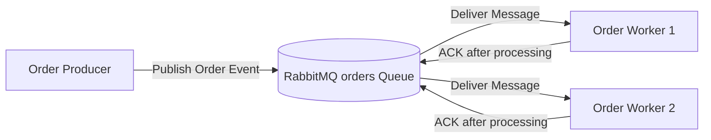
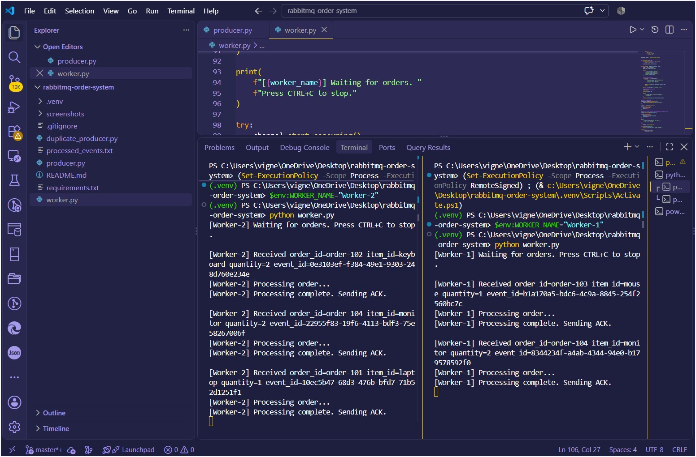
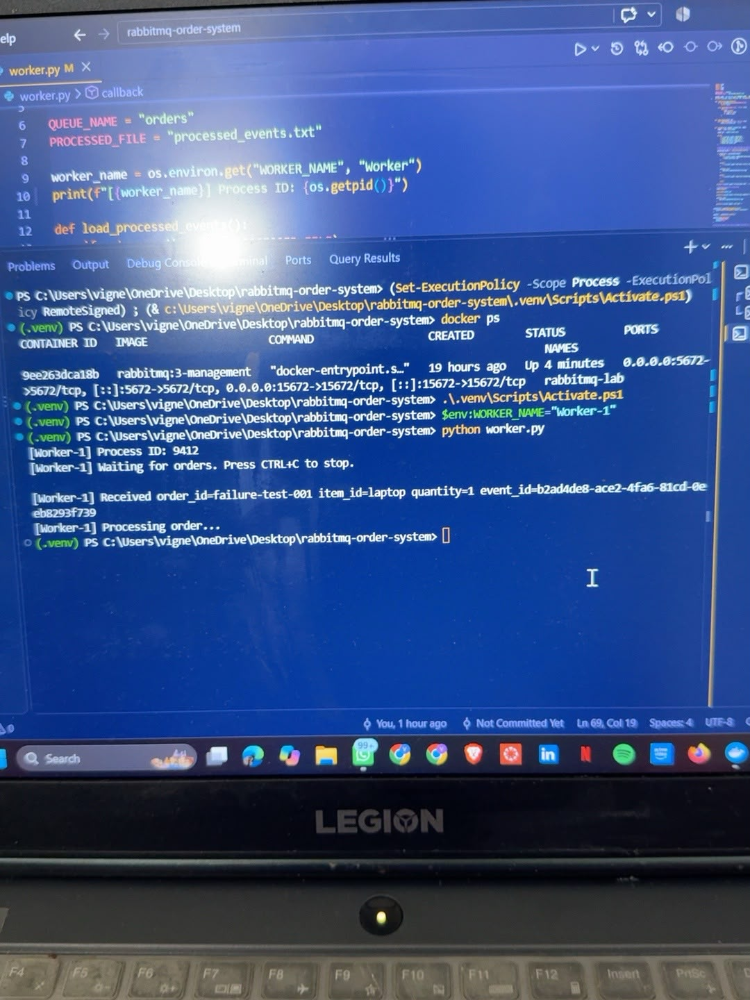
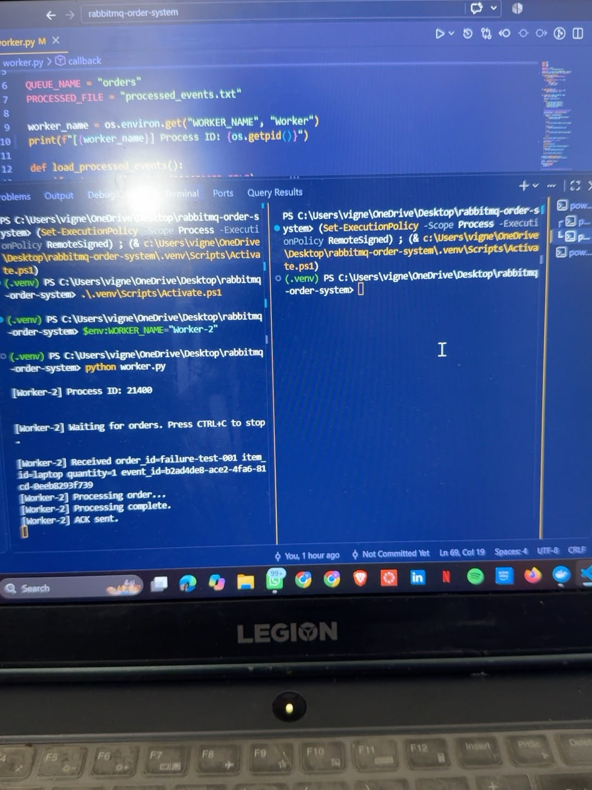
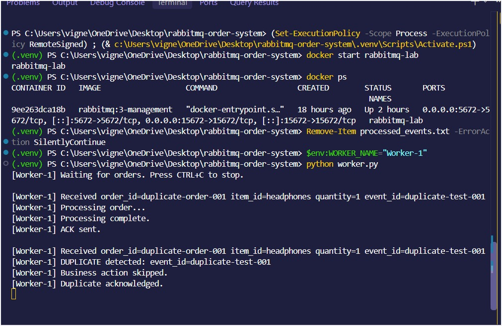

# RabbitMQ Asynchronous Order Processing System

A small asynchronous messaging system built using **Python** and **RabbitMQ**. This project demonstrates asynchronous message publishing, competing consumers, manual acknowledgments, message redelivery after worker failure, and idempotent duplicate handling.

---

## 1. Project Overview

The system consists of two main application components:

- **Order Producer** – publishes order messages to RabbitMQ.
- **Order Worker** – consumes and processes order messages.

RabbitMQ provides an `orders` queue between the producer and workers.

The producer and workers run as **independent processes**. Two worker processes connect to the same queue and operate as **competing consumers**, allowing RabbitMQ to distribute messages between them.

The system also demonstrates failure and redelivery when a worker stops before acknowledging a message, as well as duplicate handling using `event_id`.

---

## 2. Architecture



### Message Flow

```text id="yvl5gx"
Order Producer
      |
      | publishes order message
      v
+-------------------+
|     RabbitMQ      |
|   "orders" Queue  |
+-------------------+
      |         |
      |         |
      v         v
  Worker 1    Worker 2
      |         |
   Process    Process
      |         |
     ACK       ACK
```

Both workers listen to the same queue. RabbitMQ distributes messages between the available workers so that each message is normally handled by only one worker.

---

## 3. Technologies Used

- Python 3
- RabbitMQ
- Docker
- Pika
- Visual Studio Code
- Git
- GitHub

---

## 4. Project Structure

```text id="r3ssrw"
rabbitmq-order-system/
│
├── producer.py
├── worker.py
├── failure_producer.py
├── duplicate_producer.py
├── requirements.txt
├── README.md
├── .gitignore
│
└── Screenshots/
    ├── completing-consumer.jpeg
    ├── duplicate-handling.jpeg
    ├── failure-worker1.jpeg
    └── failure-worker2.jpeg
```

### File Description

| File | Purpose |
|---|---|
| `producer.py` | Publishes multiple order messages to RabbitMQ |
| `worker.py` | Consumes and processes messages and sends manual ACKs |
| `failure_producer.py` | Publishes a single message for the failure/redelivery test |
| `duplicate_producer.py` | Publishes the same `event_id` twice for duplicate testing |
| `requirements.txt` | Contains the required Python dependency |
| `Screenshots/` | Contains actual execution evidence |

---

## 5. Order Message Format

Every order message contains the four required fields:

```json id="gbzg34"
{
  "event_id": "550e8400-e29b-41d4-a716-446655440000",
  "order_id": "order-101",
  "item_id": "laptop",
  "quantity": 1
}
```

| Field | Description |
|---|---|
| `event_id` | Unique identifier for the event |
| `order_id` | Identifier for the order |
| `item_id` | Item being ordered |
| `quantity` | Quantity requested |

---

# Setup and Running Instructions

## 6. Prerequisites

The following software is required:

- Python 3
- Docker Desktop
- Git
- Visual Studio Code

---

## 7. Create and Activate the Virtual Environment

From the project directory, create a virtual environment:

```powershell id="iyvpvv"
py -m venv .venv
```

Activate it:

```powershell id="l7j0im"
.\.venv\Scripts\Activate.ps1
```

The terminal should display:

```text id="6m0e9i"
(.venv) PS ...\rabbitmq-order-system>
```

---

## 8. Install Dependencies

Install the required Python dependency:

```powershell id="04yqvo"
python -m pip install -r requirements.txt
```

The project uses:

```text id="x0b11f"
pika==1.4.4
```

The installation can be verified using:

```powershell id="1a6kbp"
python -m pip show pika
```

---

## 9. Running RabbitMQ

Start **Docker Desktop** first.

To create the RabbitMQ container for the first time:

```powershell id="kh0rbm"
docker run -d --name rabbitmq-lab -p 5672:5672 -p 15672:15672 rabbitmq:3-management
```

If the `rabbitmq-lab` container already exists:

```powershell id="wy9x39"
docker start rabbitmq-lab
```

Verify that RabbitMQ is running:

```powershell id="ddvwzj"
docker ps
```

### RabbitMQ Management Interface

Open:

```text id="xrs5mo"
http://localhost:15672
```

Default credentials:

```text id="zqew6s"
Username: guest
Password: guest
```

Port `5672` is used by the Python producer and workers. Port `15672` provides the RabbitMQ Management interface.

---

# Running the Application

## 10. Start Worker 1

Open the first VS Code PowerShell terminal:

```powershell id="03vl5f"
.\.venv\Scripts\Activate.ps1
$env:WORKER_NAME="Worker-1"
python worker.py
```

Expected startup output:

```text id="ej6qzz"
[Worker-1] Waiting for orders. Press CTRL+C to stop.
```

---

## 11. Start Worker 2

Open a second VS Code PowerShell terminal:

```powershell id="sx2ryy"
.\.venv\Scripts\Activate.ps1
$env:WORKER_NAME="Worker-2"
python worker.py
```

Expected startup output:

```text id="m1hrup"
[Worker-2] Waiting for orders. Press CTRL+C to stop.
```

Worker 1 and Worker 2 run as independent processes connected to the same RabbitMQ `orders` queue.

---

## 12. Run the Order Producer

Open a third terminal:

```powershell id="w9e6rw"
.\.venv\Scripts\Activate.ps1
python producer.py
```

The producer publishes multiple order messages containing:

- `event_id`
- `order_id`
- `item_id`
- `quantity`

Example producer output:

```text id="ptu6le"
[Producer] Published order_id=order-101
[Producer] Published order_id=order-102
[Producer] Published order_id=order-103
[Producer] Published order_id=order-104
[Producer] Finished publishing orders.
```

---

# Demonstration and Results

## 13. Successful Message Processing

When a worker receives an order, it logs the order and begins processing.

Automatic acknowledgment is disabled:

```python id="9bgmft"
auto_ack=False
```

After processing finishes, the worker explicitly sends an ACK:

```python id="7lkps6"
ch.basic_ack(delivery_tag=method.delivery_tag)
```

Example:

```text id="n6xjij"
[Worker-1] Received order_id=order-101
[Worker-1] Processing order...
[Worker-1] Processing complete.
[Worker-1] ACK sent.
```

### Execution Evidence

The following screenshot shows orders being received, processed, and acknowledged after processing.



---

## 14. Competing Consumers

Two independent worker processes are connected to the same `orders` queue.

RabbitMQ distributes messages between Worker 1 and Worker 2. Each individual message is handled by only one available worker.

Example:

```text id="iq2w6v"
Worker 1:
order-103 → Processing → ACK

Worker 2:
order-102 → Processing → ACK
order-104 → Processing → ACK
```

This demonstrates the **Competing Consumers** messaging pattern.

### Execution Evidence

The screenshot below shows Worker 1 and Worker 2 running simultaneously and processing different messages from the same RabbitMQ queue.


---

## 15. Failure and Message Redelivery

RabbitMQ uses acknowledgments to determine whether a message has been successfully processed.

The failure demonstration follows this sequence:

1. Worker 1 receives the message.
2. Worker 1 starts processing.
3. Worker 1 stops before sending the ACK.
4. The message remains unacknowledged.
5. RabbitMQ makes the message available again.
6. Worker 2 receives the same message.
7. Worker 2 completes processing.
8. Worker 2 sends the ACK.
9. RabbitMQ and the remaining worker continue running.

The failure-test message is published using:

```powershell id="3vlgzx"
python failure_producer.py
```

The same `event_id` appearing in Worker 1 and Worker 2 demonstrates that RabbitMQ redelivered the original unacknowledged message.

### Worker 1 — Failure Before ACK

Worker 1 receives `failure-test-001` and begins processing. The process is stopped before an ACK is sent.



### Worker 2 — Redelivery and ACK

Worker 2 receives the same message after Worker 1 stops. Worker 2 completes processing and sends the ACK.



This demonstrates RabbitMQ's redelivery behavior when a consumer fails before acknowledging a message.

---

## 16. Duplicate Handling

The worker keeps track of processed `event_id` values using a simple file:

```text id="2vhdbs"
processed_events.txt
```

The duplicate test is executed using:

```powershell id="3qzwhz"
python duplicate_producer.py
```

The duplicate producer deliberately publishes the same event twice:

```text id="96cfhm"
event_id=duplicate-test-001
```

### First Delivery

The first copy is processed normally:

```text id="rf0qgb"
[Worker-1] Received event_id=duplicate-test-001
[Worker-1] Processing order...
[Worker-1] Processing complete.
[Worker-1] ACK sent.
```

### Duplicate Delivery

When the same `event_id` is received again:

```text id="tzl9w8"
[Worker-1] DUPLICATE detected: event_id=duplicate-test-001
[Worker-1] Business action skipped.
[Worker-1] Duplicate acknowledged.
```

The duplicate message is acknowledged, but the business action is **not performed again**.

### Execution Evidence

The screenshot below shows the first event being processed normally and the second copy being detected as a duplicate.



---

# Reliability Features

## 17. Manual Acknowledgments

The consumer uses:

```python id="l6u8xf"
auto_ack=False
```

This prevents RabbitMQ from automatically considering a message successfully processed immediately after delivery.

The ACK is explicitly sent after processing:

```python id="4wocby"
ch.basic_ack(delivery_tag=method.delivery_tag)
```

If a worker fails before this ACK, RabbitMQ can redeliver the message.

---

## 18. Fair Message Distribution

The workers use:

```python id="x5jqod"
channel.basic_qos(prefetch_count=1)
```

This limits each worker to one unacknowledged message at a time and helps distribute messages between available competing consumers.

---

## 19. Durable Queue and Persistent Messages

The queue is declared as durable:

```python id="8t3huj"
channel.queue_declare(
    queue="orders",
    durable=True
)
```

Messages are published with:

```python id="5l9xqv"
delivery_mode=2
```

This marks the messages as persistent.

---

## 20. Idempotent Message Handling

Every message contains an `event_id`.

Processed event IDs are stored in:

```text id="5thzsn"
processed_events.txt
```

Before performing the business action, the worker checks whether the `event_id` has already been processed.

If it has already been processed, the worker logs:

```text id="ts61hs"
DUPLICATE detected
Business action skipped.
```

The duplicate is acknowledged without performing the business operation again.

This provides **idempotent handling** of duplicate message deliveries.

---

# Evidence Summary

## 21. Execution Evidence

| Assignment Requirement | Evidence |
|---|---|
| Successful message processing and ACK | [View Evidence](Screenshots/completing-consumer.jpeg) |
| Two competing consumers | [View Evidence](Screenshots/completing-consumer.jpeg) |
| Worker 1 receives message but stops before ACK | [View Evidence](Screenshots/failure-worker1.jpeg) |
| Worker 2 receives the redelivered message and sends ACK | [View Evidence](Screenshots/failure-worker2.jpeg) |
| Duplicate detected and business action skipped | [View Evidence](Screenshots/duplicate-handling.jpeg) |

---

# Reflection

## 22. Why Can a Message Be Delivered More Than Once, and How Does Idempotent Handling Help?

A RabbitMQ message can be delivered more than once when a consumer receives the message but fails before sending an acknowledgment. RabbitMQ cannot determine whether the business operation completed successfully, so the unacknowledged message can be delivered to another consumer. Idempotent handling prevents the same business action from being performed multiple times by keeping track of previously processed `event_id` values. This allows the application to safely handle message redelivery and duplicate messages.

---

# Conclusion

This project demonstrates asynchronous messaging using RabbitMQ and Python. The producer and workers run as independent processes, while RabbitMQ distributes messages between two competing consumers. Manual acknowledgments allow unacknowledged messages to be redelivered after a worker failure, while `event_id` tracking provides idempotent handling and prevents duplicate business actions.