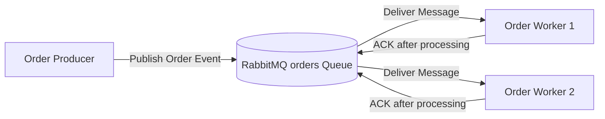

# RabbitMQ Asynchronous Order Processing System

A small asynchronous messaging system built using **Python** and **RabbitMQ**. This project demonstrates asynchronous message publishing, competing consumers, manual acknowledgments, failure and message redelivery, and idempotent duplicate handling.

---

## 1. Project Overview

The system consists of:

- **Order Producer** — publishes order messages.
- **RabbitMQ** — stores and distributes messages through the `orders` queue.
- **Order Worker** — consumes and processes order messages.

The producer and workers run as **independent processes**. Two worker processes connect to the same queue and act as competing consumers.

The system also demonstrates what happens when a worker stops before acknowledging a message and how duplicate events can be safely handled using `event_id`.

---

## 2. Architecture



### Message Flow

```text
Order Producer
      |
      | publishes order
      v
+-------------------+
|     RabbitMQ      |
|   "orders" Queue  |
+-------------------+
      |         |
      |         |
      v         v
  Worker 1    Worker 2
      |         |
   Process    Process
      |         |
     ACK       ACK
```

Both workers listen to the same queue. RabbitMQ distributes messages between available workers so that each message is normally handled by only one worker.

---

## 3. Technologies Used

- Python 3
- RabbitMQ
- Docker
- Pika
- Visual Studio Code
- Git
- GitHub

---

## 4. Project Structure

```text
rabbitmq-order-system/
│
├── producer.py
├── worker.py
├── failure_producer.py
├── duplicate_producer.py
├── requirements.txt
├── README.md
├── .gitignore
│
└── Screenshots/
    ├── completing-consumer.jpeg
    ├── duplicate-handling.jpeg
    ├── failure-worker1.jpeg
    └── failure-worker2.jpeg
```

### File Description

| File | Purpose |
|---|---|
| `producer.py` | Publishes multiple order messages to RabbitMQ |
| `worker.py` | Consumes and processes order messages and sends manual ACKs |
| `failure_producer.py` | Publishes one message for the failure and redelivery demonstration |
| `duplicate_producer.py` | Publishes the same `event_id` twice |
| `requirements.txt` | Contains the Python dependency |
| `Screenshots/` | Contains execution evidence |

---

## 5. Order Message Format

Every order message contains:

```json
{
  "event_id": "550e8400-e29b-41d4-a716-446655440000",
  "order_id": "order-101",
  "item_id": "laptop",
  "quantity": 1
}
```

| Field | Description |
|---|---|
| `event_id` | Unique identifier for the event |
| `order_id` | Identifier for the order |
| `item_id` | Item being ordered |
| `quantity` | Quantity requested |

---

# Setup and Running Instructions

## 6. Prerequisites

Install:

- Python 3
- Docker Desktop
- Git
- Visual Studio Code

---

## 7. Create and Activate the Virtual Environment

Create the environment:

```powershell
py -m venv .venv
```

Activate it:

```powershell
.\.venv\Scripts\Activate.ps1
```

The terminal should display:

```text
(.venv) PS ...\rabbitmq-order-system>
```

---

## 8. Install Dependencies

Install the required package:

```powershell
python -m pip install -r requirements.txt
```

The project uses:

```text
pika==1.4.4
```

The installation can be verified using:

```powershell
python -m pip show pika
```

---

## 9. Running RabbitMQ

Start **Docker Desktop** first.

For the initial RabbitMQ container creation:

```powershell
docker run -d --name rabbitmq-lab -p 5672:5672 -p 15672:15672 rabbitmq:3-management
```

If the container already exists:

```powershell
docker start rabbitmq-lab
```

Verify that it is running:

```powershell
docker ps
```

### RabbitMQ Management Interface

Open:

```text
http://localhost:15672
```

Credentials:

```text
Username: guest
Password: guest
```

Port `5672` is used by the Python applications. Port `15672` provides the RabbitMQ Management interface.

---

# Running the Application

## 10. Start Worker 1

Open the first VS Code PowerShell terminal:

```powershell
.\.venv\Scripts\Activate.ps1
$env:WORKER_NAME="Worker-1"
python worker.py
```

Expected startup output:

```text
[Worker-1] Waiting for orders. Press CTRL+C to stop.
```

---

## 11. Start Worker 2

Open a second terminal:

```powershell
.\.venv\Scripts\Activate.ps1
$env:WORKER_NAME="Worker-2"
python worker.py
```

Expected startup output:

```text
[Worker-2] Waiting for orders. Press CTRL+C to stop.
```

Worker 1 and Worker 2 are independent processes connected to the same RabbitMQ queue.

---

## 12. Run the Order Producer

Open a third terminal:

```powershell
.\.venv\Scripts\Activate.ps1
python producer.py
```

The producer publishes multiple order messages containing:

- `event_id`
- `order_id`
- `item_id`
- `quantity`

Example:

```text
[Producer] Published order_id=order-101
[Producer] Published order_id=order-102
[Producer] Published order_id=order-103
[Producer] Published order_id=order-104
[Producer] Finished publishing orders.
```

---

# Demonstration and Results

## 13. Successful Message Processing

When a worker receives an order, it logs the order and begins processing.

The worker uses:

```python
auto_ack=False
```

Therefore, RabbitMQ does not automatically acknowledge the message.

After processing completes, the worker explicitly sends:

```python
ch.basic_ack(delivery_tag=method.delivery_tag)
```

Example:

```text
[Worker-1] Received order_id=order-101
[Worker-1] Processing order...
[Worker-1] Processing complete.
[Worker-1] ACK sent.
```

### Evidence — Successful Processing

The following execution evidence shows orders being received, processed, and acknowledged.


---

## 14. Competing Consumers

Two independent worker processes are connected to the same `orders` queue.

RabbitMQ distributes messages between Worker 1 and Worker 2. Each individual message is handled by only one available worker.

Example:

```text
Worker 1:
order-103 → Processing → ACK

Worker 2:
order-102 → Processing → ACK
order-104 → Processing → ACK
```

This demonstrates the **Competing Consumers** pattern.

### Evidence — Competing Consumers

The screenshot below shows Worker 1 and Worker 2 running simultaneously and receiving different messages from the same RabbitMQ queue.


---

## 15. Failure and Message Redelivery

RabbitMQ uses acknowledgments to determine whether a message has been successfully processed.

The failure test follows this sequence:

1. Worker 1 receives a message.
2. Worker 1 starts processing.
3. Worker 1 stops before sending the ACK.
4. RabbitMQ detects that the message was not acknowledged.
5. The message becomes available for redelivery.
6. Worker 2 receives the same message.
7. Worker 2 finishes processing.
8. Worker 2 sends the ACK.
9. RabbitMQ and the remaining worker continue running.

The test message is published using:

```powershell
python failure_producer.py
```

The same `event_id` appearing in both worker outputs demonstrates that the original message was redelivered rather than a new message being created.

### Evidence — Worker 1 Stops Before ACK

Worker 1 receives `failure-test-001` and begins processing the message. It stops before completing processing and sending an ACK.


### Evidence — Worker 2 Receives the Redelivered Message

Worker 2 receives the same `failure-test-001` event, completes processing, and sends an ACK.


This demonstrates RabbitMQ's redelivery behavior when a consumer fails before acknowledging a message.

---

## 16. Duplicate Handling

Processed `event_id` values are stored in:

```text
processed_events.txt
```

The duplicate test is executed using:

```powershell
python duplicate_producer.py
```

The producer deliberately publishes the same event twice:

```text
event_id=duplicate-test-001
```

### First Delivery

The first delivery is processed normally:

```text
[Worker-1] Received event_id=duplicate-test-001
[Worker-1] Processing order...
[Worker-1] Processing complete.
[Worker-1] ACK sent.
```

### Second Delivery

When the same `event_id` arrives again:

```text
[Worker-1] DUPLICATE detected: event_id=duplicate-test-001
[Worker-1] Business action skipped.
[Worker-1] Duplicate acknowledged.
```

The duplicate message is acknowledged, but the business operation is **not performed again**.

### Evidence — Duplicate Handling

The following screenshot shows the first event being processed normally and the second copy being detected as a duplicate.


---

# Reliability Features

## 17. Manual Acknowledgments

The worker uses:

```python
auto_ack=False
```

The ACK is sent only after processing has completed:

```python
ch.basic_ack(delivery_tag=method.delivery_tag)
```

This allows RabbitMQ to redeliver an unacknowledged message if a worker fails.

---

## 18. Fair Message Distribution

The workers use:

```python
channel.basic_qos(prefetch_count=1)
```

This limits each worker to one unacknowledged message at a time and helps distribute messages between the two competing consumers.

---

## 19. Durable Queue and Persistent Messages

The queue is declared as durable:

```python
channel.queue_declare(
    queue="orders",
    durable=True
)
```

Messages are published with:

```python
delivery_mode=2
```

This marks the messages as persistent.

---

## 20. Idempotent Message Handling

Every message contains an `event_id`.

Processed event IDs are recorded in:

```text
processed_events.txt
```

Before executing the business action, the worker checks whether the `event_id` was previously processed.

If the event has already been processed:

```text
DUPLICATE detected
Business action skipped.
```

This prevents duplicate deliveries from causing the same business operation to execute more than once.

---

# Evidence Summary

## 21. Execution Evidence

| Requirement | Evidence |
|---|---|
| Successful message processing and ACK | [View Evidence](Screenshots/completing-consumer.jpeg) |
| Two competing consumers | [View Evidence](Screenshots/completing-consumer.jpeg) |
| Worker 1 receives message but stops before ACK | [View Evidence](Screenshots/failure-worker1.jpeg) |
| Worker 2 receives the redelivered message and ACKs it | [View Evidence](Screenshots/failure-worker2.jpeg) |
| Duplicate event detection and skipped business action | [View Evidence](Screenshots/duplicate-handling.jpeg) |

---

# Reflection

## 22. Why Can a Message Be Delivered More Than Once, and How Does Idempotent Handling Help?

A RabbitMQ message can be delivered more than once when a consumer receives the message but fails before sending an acknowledgment. RabbitMQ cannot determine whether the business operation completed successfully, so an unacknowledged message can be delivered to another consumer. Idempotent handling prevents the same business action from being performed multiple times by keeping track of previously processed `event_id` values. This allows the application to safely handle message redelivery and duplicate messages.

---

# Conclusion

This project demonstrates asynchronous messaging using RabbitMQ and Python. The producer and workers run as independent processes, and RabbitMQ distributes messages between two competing consumers. Manual acknowledgments allow unacknowledged messages to be redelivered after a worker failure, while `event_id` tracking provides idempotent handling and prevents duplicate business actions.
